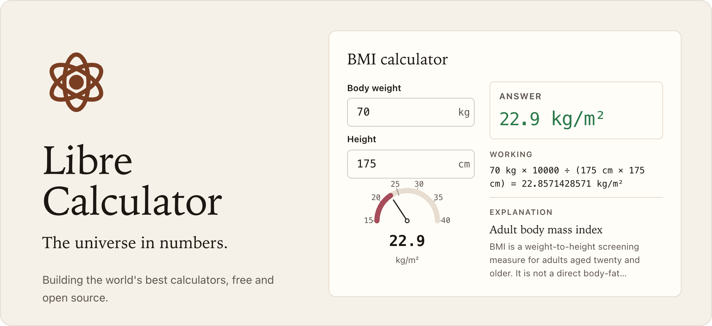
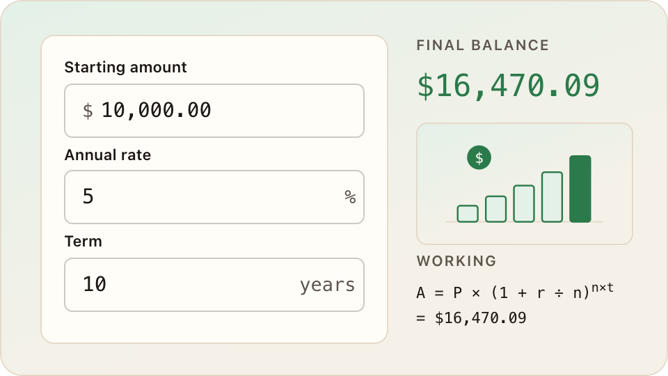
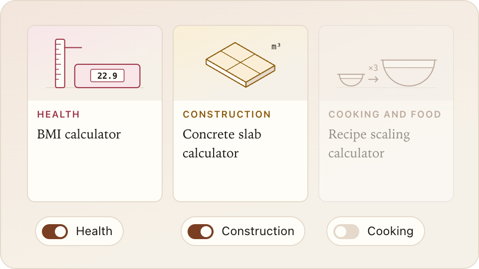
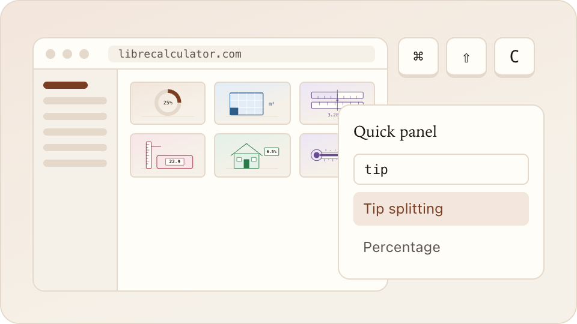
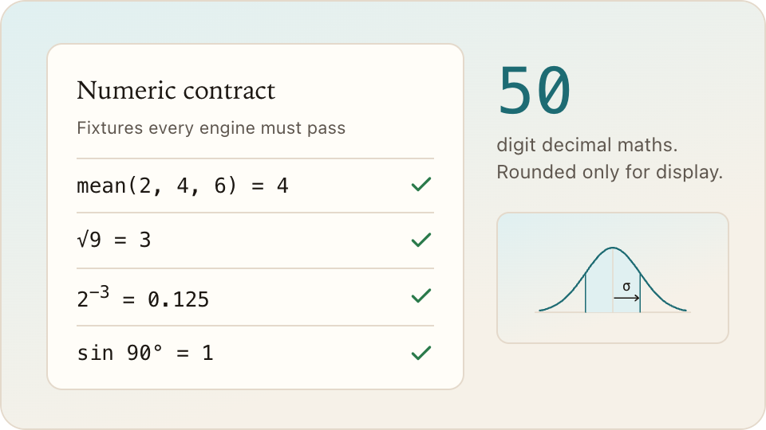
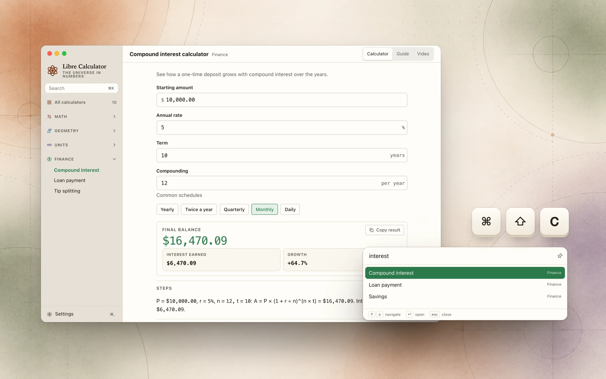
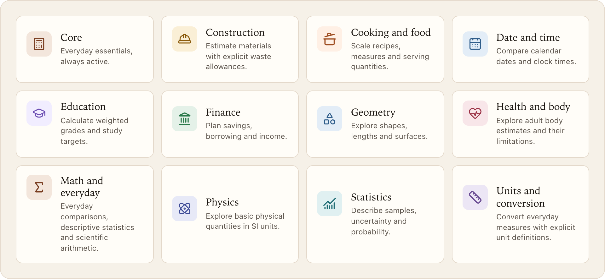

<div align="center">

<picture>
  <source media="(prefers-color-scheme: dark)" srcset=".github/readme/hero-dark.png">
  
</picture>

<h1>Libre Calculator</h1>

The universe in numbers.<br>
Building the world's best calculators, free and open source.

[Website](https://librecalculator.com) · [Download](https://librecalculator.com/download/) · [Calculator packs](#calculator-packs) · [Get started](#get-started) · [Ways to help](#ways-to-help) · [Docs](docs/README.md)

[](https://github.com/tonyzedginidze/librecalculator/stargazers)
[](https://github.com/tonyzedginidze/librecalculator/commits/main)
[](https://github.com/tonyzedginidze/librecalculator/issues)
[](https://github.com/tonyzedginidze/librecalculator/releases/latest)
[](https://bun.sh)

</div>

<br>

<a href="https://github.com/tonyzedginidze/librecalculator/stargazers">
  <picture>
    <source media="(prefers-color-scheme: dark)" srcset=".github/readme/star-dark.png">
    
  </picture>
</a>

## Why Libre Calculator

<table>
<tr>
<td width="50%" valign="top">
<picture>
  <source media="(prefers-color-scheme: dark)" srcset=".github/readme/f-working-dark.png">
  
</picture>

<h3>Explains every answer</h3>

Each result shows the steps that produced it, with a diagram and a short lesson underneath.

- Steps use your inputs, not a generic example
- Answer, steps and diagram come from one calculation
- Lessons explain the idea behind the formula

</td>
<td width="50%" valign="top">
<picture>
  <source media="(prefers-color-scheme: dark)" srcset=".github/readme/f-packs-dark.png">
  
</picture>

<h3>Packs you switch on</h3>

Core is always on. Turn on health, cooking, construction and the rest when you need them.

- Every calculator has its own page on the web
- Active packs are cached for offline use
- The catalog is built to grow to thousands

</td>
</tr>
<tr>
<td width="50%" valign="top">
<picture>
  <source media="(prefers-color-scheme: dark)" srcset=".github/readme/f-platforms-dark.png">
  
</picture>

<h3>Web and desktop</h3>

Use it at librecalculator.com, or run the desktop app. <kbd>Cmd/Ctrl</kbd> <kbd>Shift</kbd> <kbd>C</kbd> opens a quick panel from anywhere to find a calculator.

- Static website, one page per calculator
- Desktop app built with Tauri
- Same calculators and design on both

</td>
<td width="50%" valign="top">
<picture>
  <source media="(prefers-color-scheme: dark)" srcset=".github/readme/f-exact-dark.png">
  
</picture>

<h3>Exact by contract</h3>

Engines are pure functions with written numeric contracts and fixture tests. Arithmetic runs on 50-digit decimals and is rounded only for display.

- Contracts per domain in [`docs/`](docs/README.md)
- Every engine has fixture tests in `bun test`
- Invalid input fails clearly instead of guessing

</td>
</tr>
</table>

## Desktop app

<a href="https://librecalculator.com/download/">
  <picture>
    <source media="(prefers-color-scheme: dark)" srcset=".github/readme/desktop-dark.webp">
    
  </picture>
</a>

<div align="center">

Every calculator in a window of its own. Press <kbd>Cmd/Ctrl</kbd> <kbd>Shift</kbd> <kbd>C</kbd> in any app, type a few letters, and the calculator opens.

[](https://github.com/tonyzedginidze/librecalculator/releases/latest)
[](https://github.com/tonyzedginidze/librecalculator/releases/latest)
[](https://github.com/tonyzedginidze/librecalculator/releases/latest)

Free and open source. [librecalculator.com/download](https://librecalculator.com/download/) picks the right file for your computer.

</div>

## Calculator packs

<picture>
  <source media="(prefers-color-scheme: dark)" srcset=".github/readme/packs-dark.png">
  
</picture>

<details>
<summary><b>See every calculator</b></summary>
<br>

| Pack | Calculators |
|---|---|
| **Core** | [Percentage](https://librecalculator.com/calculators/percentage), [Percentage change](https://librecalculator.com/calculators/percentage-change), [Fraction](https://librecalculator.com/calculators/fractions), [Unit conversion](https://librecalculator.com/calculators/unit-conversion), [Area](https://librecalculator.com/calculators/area), [Volume](https://librecalculator.com/calculators/volume), [Pythagorean theorem](https://librecalculator.com/calculators/pythagorean-theorem), [Compound interest](https://librecalculator.com/calculators/compound-interest), [Loan payment](https://librecalculator.com/calculators/loan-payments), [Tip splitting](https://librecalculator.com/calculators/tip-splitting) |
| **Construction** | [Concrete slab](https://librecalculator.com/calculators/concrete), [Paint](https://librecalculator.com/calculators/paint), [Flooring](https://librecalculator.com/calculators/flooring), [Roof area](https://librecalculator.com/calculators/roofing), [Tile](https://librecalculator.com/calculators/tile), [Board foot](https://librecalculator.com/calculators/lumber) |
| **Cooking and food** | [Recipe scaling](https://librecalculator.com/calculators/recipe-scaling), [Cups to grams](https://librecalculator.com/calculators/cup-gram-conversion), [Oven temperature](https://librecalculator.com/calculators/oven-temperature), [Baker's percentage](https://librecalculator.com/calculators/baking-ratios), [Calories per serving](https://librecalculator.com/calculators/calories-per-serving) |
| **Date and time** | [Age](https://librecalculator.com/calculators/age), [Date difference](https://librecalculator.com/calculators/date-difference), [Days until](https://librecalculator.com/calculators/countdown), [Work hours](https://librecalculator.com/calculators/work-hours), [Time zone converter](https://librecalculator.com/calculators/time-zone) |
| **Education** | [GPA](https://librecalculator.com/calculators/gpa), [Grade](https://librecalculator.com/calculators/grade), [Final grade](https://librecalculator.com/calculators/final-grade), [Test score](https://librecalculator.com/calculators/test-score) |
| **Finance** | [Mortgage](https://librecalculator.com/calculators/mortgage), [Savings](https://librecalculator.com/calculators/savings), [ROI](https://librecalculator.com/calculators/roi), [Salary to hourly](https://librecalculator.com/calculators/salary), [Margin and markup](https://librecalculator.com/calculators/margin-markup), [Inflation](https://librecalculator.com/calculators/inflation), [Retirement savings](https://librecalculator.com/calculators/retirement) |
| **Geometry** | [Rectangle](https://librecalculator.com/calculators/rectangle), [Triangle](https://librecalculator.com/calculators/triangle), [Circle](https://librecalculator.com/calculators/circle), [Sphere](https://librecalculator.com/calculators/sphere), [Cylinder](https://librecalculator.com/calculators/cylinder) |
| **Health and body** | [BMI](https://librecalculator.com/calculators/bmi), [Resting energy (BMR)](https://librecalculator.com/calculators/bmr), [Daily energy (TDEE)](https://librecalculator.com/calculators/tdee), [Macros](https://librecalculator.com/calculators/macros), [Body fat estimate](https://librecalculator.com/calculators/body-fat), [Water intake](https://librecalculator.com/calculators/water-intake), [Weight at a chosen BMI](https://librecalculator.com/calculators/ideal-weight) |
| **Math and everyday** | [Discount](https://librecalculator.com/calculators/discount), [Mean, median and mode](https://librecalculator.com/calculators/average), [Standard deviation](https://librecalculator.com/calculators/standard-deviation), [Ratio](https://librecalculator.com/calculators/ratio), [Scientific functions](https://librecalculator.com/calculators/scientific), [Random number picker](https://librecalculator.com/calculators/random-number), [Fuel economy](https://librecalculator.com/calculators/fuel-economy) |
| **Physics** | [Speed](https://librecalculator.com/calculators/speed), [Force](https://librecalculator.com/calculators/force), [Kinetic energy](https://librecalculator.com/calculators/energy), [Power](https://librecalculator.com/calculators/power), [Density](https://librecalculator.com/calculators/density), [Pressure](https://librecalculator.com/calculators/pressure) |
| **Statistics** | [Z-score](https://librecalculator.com/calculators/z-score), [Confidence interval](https://librecalculator.com/calculators/confidence-interval), [Probability](https://librecalculator.com/calculators/probability), [Weighted average](https://librecalculator.com/calculators/weighted-average) |
| **Units and conversion** | [Length](https://librecalculator.com/calculators/length), [Mass and weight](https://librecalculator.com/calculators/mass), [Temperature](https://librecalculator.com/calculators/temperature), [Speed](https://librecalculator.com/calculators/speed-conversion), [Time duration](https://librecalculator.com/calculators/duration), [Cooking measures](https://librecalculator.com/calculators/cooking-measures) |

</details>

## Get started

The quickest way is the website: [librecalculator.com](https://librecalculator.com).

Or get the [desktop app](https://librecalculator.com/download/) for macOS, Windows (x64 and ARM) and Linux (deb, rpm and AppImage, x64 and ARM). Every build is also on the [releases page](https://github.com/tonyzedginidze/librecalculator/releases/latest).

To run it locally you need Bun **1.4.2** and Node **24.21.0**.

```sh
git clone https://github.com/tonyzedginidze/librecalculator.git
cd librecalculator
bun install --frozen-lockfile
bun run dev            # website at http://localhost:4321
bun run dev:desktop    # desktop app (needs the Tauri prerequisites)
```

## Add a calculator

New calculators start from one command. The generator is the registry, so nothing needs wiring by hand.

```sh
bun run new <id> [category]
```

Then replace the cloned engine, lesson, strings and view, and add the tile illustration. [docs/new-calculator.md](docs/new-calculator.md) has the full checklist and the definition of done.

Before opening a pull request, all of these must pass:

```sh
bun run generate && bun run check:generated && bun run check:web-topics
bun run content-check && bun test && bun run typecheck && bun run lint
bun run build:web
```

## How it is built

| Path | What lives there |
|---|---|
| `packages/calculators` | Pure calculation engines and their tests |
| `packages/content` | Lesson text |
| `packages/i18n` | Every user-visible string |
| `packages/dom-ui` | Shared React calculator views |
| `packages/design` | Design tokens and styles |
| `packs/` | Pack manifests that group calculators |
| `apps/web` | Astro website, one page per calculator |
| `apps/desktop` | Tauri app with the quick panel |

More in [docs/architecture.md](docs/architecture.md), [docs/packs.md](docs/packs.md) and [docs/design-system.md](docs/design-system.md).

## Ways to help

You don't need to write code to make Libre Calculator better.

| | How |
|---|---|
| **Star the repo** | A star takes one second and is the clearest sign the project is worth building. It helps people find Libre Calculator in GitHub search and trending lists, brings in more reviewers and contributors, and tells us which direction to keep growing. |
| **Review a calculator** | Pick one you know well and check its answer, steps and lesson. If a number, unit or explanation is off, [open an issue](https://github.com/tonyzedginidze/librecalculator/issues/new) with the inputs you used. |
| **Suggest a calculator** | Tell us what you wanted to calculate and couldn't. Real questions make the best calculators. |
| **Improve a lesson** | Clearer wording, a better example or a common mistake worth mentioning. Lessons live in `packages/content`. |
| **Translate** | All text already lives in `packages/i18n`, ready for other languages. Translation isn't open yet; tell us which language you'd help with so we can start there. |
| **Draw a tile** | Each calculator has a small flat illustration. [docs/tile-illustrations.md](docs/tile-illustrations.md) has the house style. |
| **Report a bug** | Wrong results, broken layouts and accessibility problems all count. |
| **Try the desktop app** | Run it on your system and tell us what breaks or feels slow. |
| **Share it** | Send a calculator to a friend, a teacher or a colleague who would use it. |
| **Build a calculator** | Follow [Add a calculator](#add-a-calculator). Open an issue first so we can agree on scope. |

### Contributors

<a href="https://github.com/tonyzedginidze/librecalculator/graphs/contributors">
  
</a>

<sub>README art is rendered from the live site with `bun run build:web && bun run readme:art`.</sub>
